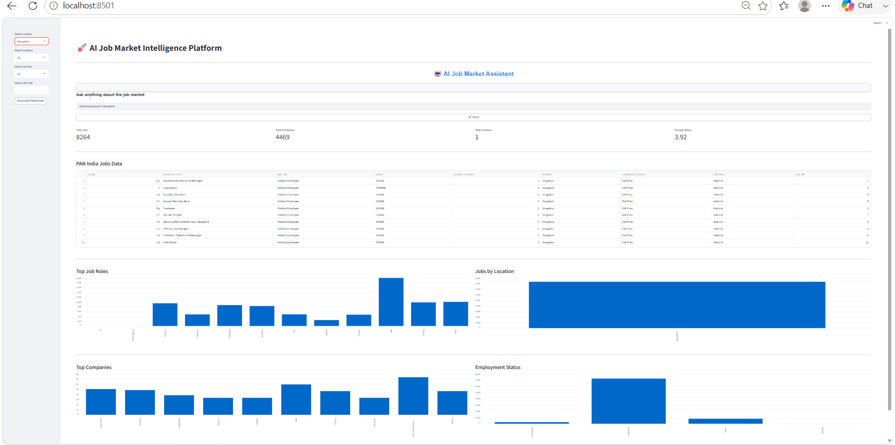
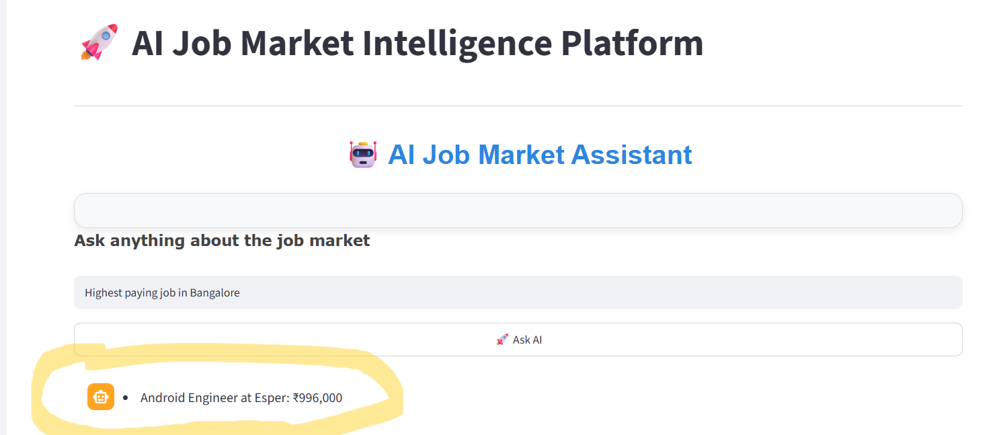
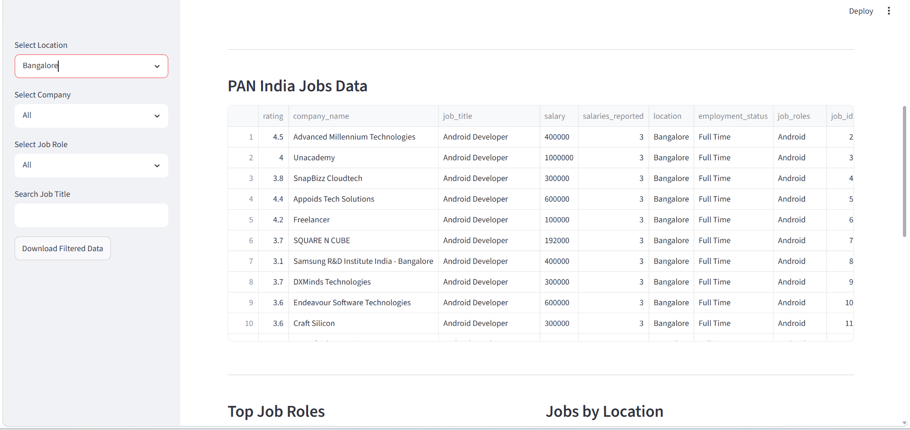
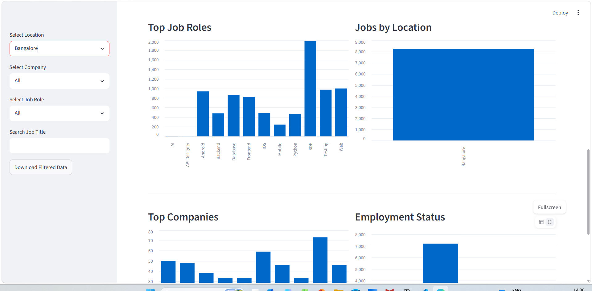
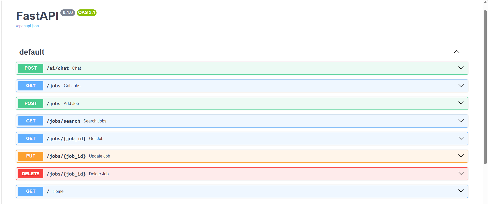
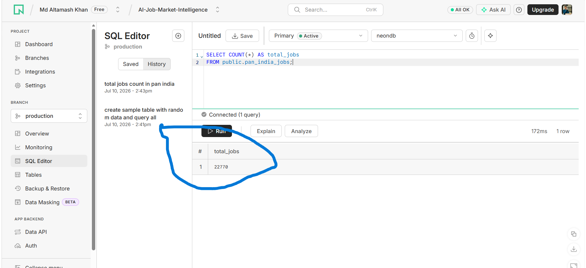

# 🚀 AI Job Market Intelligence Platform

An end-to-end Data Engineering and AI-powered Job Analytics project built using Python, PostgreSQL, FastAPI, Streamlit, and Google Gemini AI.

This project demonstrates the complete data pipeline—from raw CSV files to a cloud-hosted AI-powered dashboard.

---

# 📌 Project Overview

The goal of this project is to analyze job market data across India and allow users to:

- Search jobs
- Filter jobs
- Analyze companies
- View job statistics
- Ask questions in natural language using AI

The AI automatically converts user questions into SQL queries and returns human-friendly answers.

---

# 🛠️ Tech Stack

### Programming Language
- Python

### Data Analysis & Visualization
- Pandas
- Matplotlib

### Dataset
- Kaggle

### Database
- PostgreSQL
- Neon PostgreSQL (Cloud Database)

### Backend
- FastAPI
- REST API

### Frontend
- Streamlit

### Artificial Intelligence
- Google Gemini AI

### Version Control
- Git
- GitHub

---

# 📂 Project Journey

Instead of directly building the dashboard, this project was developed step by step.

## Step 1 — Python Practice

Started with Python basics to understand:

- Variables
- Functions
- Loops
- File Handling
- Pandas

Created small practice scripts before working on the real dataset.

---

## Step 2 — Small Dataset

Initially worked with a small dataset:

```
jobs.csv
```

Learned how to:

- Read CSV files
- Display data
- Check rows and columns
- Understand dataset structure

Example:

```python
pd.read_csv("jobs.csv")
```

---

## Step 3 — Large Dataset

After understanding the small dataset, switched to a real-world dataset:

```
Newdata.csv
```

This dataset contains thousands of job records collected across India.

---

## Step 4 — Data Analysis

Analyzed the dataset using Pandas.

Performed tasks like:

- Viewing columns
- Checking null values
- Understanding data types
- Finding duplicate records
- Exploring job roles
- Exploring company names
- Exploring locations

---

## Step 5 — Data Cleaning

Cleaned the dataset by:

- Removing unnecessary values
- Fixing missing data
- Standardizing columns
- Formatting text
- Preparing the dataset for database storage

Generated:

```
cleaned_newdata_utf8.csv
```

---

## Step 6 — PostgreSQL

Created a PostgreSQL database.

Created the table:

```
pan_india_jobs
```

Imported the cleaned_newdata_utf8.csv into PostgreSQL.

Learned:

- CREATE TABLE
- COPY
- SELECT
- WHERE
- GROUP BY
- ORDER BY
- LIMIT
- Aggregate Functions

---

## Step 7 — FastAPI Backend

# FastAPI Swagger


Built a RESTful backend using **FastAPI** to connect the dashboard with the PostgreSQL database.

Implemented complete CRUD (Create, Read, Update, Delete) operations along with AI-powered APIs.

### Available API Endpoints

#### Create Job

```http
POST /jobs
```

Adds a new job record to the database.

---

#### Read All Jobs

```http
GET /jobs
```

Fetches all job records from the database.

---

#### Search Jobs

```http
GET /jobs/search
```

Searches jobs based on filters such as company, location, or job title.

---

#### Update Job

```http
PUT /jobs/{job_id}
```

Updates an existing job record.

---

#### Delete Job

```http
DELETE /jobs/{job_id}
```

Deletes a job record from the database.

All job write endpoints (`POST /jobs`, `PUT /jobs/{job_id}`, and
`DELETE /jobs/{job_id}`) require an `Authorization: Bearer <token>` header.
Configure the token as `API_WRITE_TOKEN` in the backend environment; if it is
unset or empty, write requests fail closed with HTTP 503. Keep the token out of
source control and browser-delivered dashboard code. Read endpoints do not
require this token.

---

#### AI Job Assistant

```http
POST /ai/chat
```

Allows users to ask questions in natural language.

The AI converts the question into a PostgreSQL query, securely executes it on the database, and returns a human-readable response.

---

### Backend Features

- CRUD Operations
- REST APIs
- Database Integration
- AI-powered SQL Generation
- SQL Security Validation
- JSON Responses
- Error Handling
- Cloud Database Support (Neon PostgreSQL)
---

## Step 8 — Streamlit Dashboard


Built an interactive dashboard.

Features:

- Search Job Title
- Filter by Company
- Filter by Location
- Filter by Job Role
- Download Filtered Data
- Interactive Charts
- Metrics
- AI Chat Assistant

---

## Step 9 — AI Integration

# AI Assistant


Integrated Google Gemini AI.

Workflow:

User Question

↓

Gemini converts question into SQL

↓

FastAPI validates SQL

↓

SQL executes on PostgreSQL

↓

Gemini explains results in simple English

Example:

User:

> Highest paying jobs in Bangalore

Generated SQL:

```sql
SELECT ...
```

AI Response:

> The highest paying job available in Bangalore is...

---

## Step 10 — SQL Security

Implemented security rules:

✔ Only SELECT queries allowed

Blocked:

- INSERT
- UPDATE
- DELETE
- DROP
- ALTER
- TRUNCATE
- CREATE
- GRANT
- REVOKE

Protected against multiple SQL statements.

Allowed only:

```
public.pan_india_jobs
```

---

## Step 11 — Cloud Database

# Neon Cloud Database


Migrated the entire PostgreSQL database to:

Neon PostgreSQL

Successfully migrated:

- Schema
- Primary Key
- Job IDs
- 22,770 Job Records

This project history records a migration to Neon PostgreSQL. Current production
connectivity is not verified by the local development setup below.

---

# 📊 Dashboard Features

# Dashboard


✔ AI Job Assistant

✔ Search Jobs

✔ Company Filter

✔ Location Filter

✔ Job Role Filter

✔ Download CSV

✔ Charts

✔ Metrics

✔ Responsive Dashboard

---

# 📁 Folder Structure

```text
AI-Job-Market-Intelligence
│
├── api/
|__ routers/
├── dashboard/
├── data/
├── scripts/
├── sql/
├── notebooks/
├── README.md
├── requirements.txt
└── .gitignore
```

---

# 🚀 Project Workflow

```
Raw CSV

↓

Data Analysis

↓

Data Cleaning

↓

PostgreSQL

↓

Neon Cloud Database

↓

FastAPI APIs

↓

Gemini AI

↓

Streamlit Dashboard

↓

End User
```

---

# Future Improvements

- Authentication
- Docker
- Kubernetes
- CI/CD
- Job Recommendation Engine
- Resume Matching
- Salary Prediction
- AI Career Advisor

---

# Dashboard



---

# AI Job Market Assistant



---

# Filters

Users can filter jobs by:

- Location
- Company
- Job Role
- Job Title



---

# Data Visualization

Interactive charts provide insights into the job market.



---

# FastAPI Swagger



---

# Neon Cloud Database



---


# Author

Md Altamash Khan

## Local setup and configuration

Use Python 3.11 or a compatible Python 3 version supported by the pinned
dependencies. Copy `.env.example` to `.env` and replace the database placeholders
with values for the database you intend to use. Keep `.env` out of Git.

The API reads these database settings:

| Variable | Purpose |
| --- | --- |
| `DB_HOST` | PostgreSQL host |
| `DB_NAME` | Database name |
| `DB_USER` | PostgreSQL role |
| `DB_PASSWORD` | Database password; required for remote database connections |
| `DB_PORT` | PostgreSQL port |
| `DB_SSLMODE` | PostgreSQL SSL mode; defaults to `require` |

Passwordless authentication is allowed only when `DB_HOST` is a loopback host
and `DB_SSLMODE=disable`, for a local PostgreSQL cluster explicitly configured
for trust authentication. Remote deployments must set `DB_PASSWORD` and retain
`DB_SSLMODE=require`.

The real Streamlit dashboard also requires `API_URL`, the base URL of the
FastAPI service. For local development, set `API_URL=http://127.0.0.1:8000`.
The dashboard validates this value and does not fall back to localhost when it
is absent or invalid. In production, configure it to the deployed API service
URL, not the dashboard's own URL or localhost.

Create and activate a virtual environment, copy the example configuration,
replace its placeholders, and install dependencies from the repository root:

```sh
python3 -m venv .venv
source .venv/bin/activate
if [ ! -e .env ]; then cp .env.example .env; fi
python -m pip install -r requirements.txt
```

Run the local services from the repository root in separate terminals:

```sh
python -m uvicorn api.main:app --host 127.0.0.1 --port 8000
```

```sh
streamlit run dashboard/app_real.py
```

Set `API_WRITE_TOKEN` in the backend environment to enable `POST`, `PUT`, and
`DELETE` job endpoints. Keep it only on the backend; the dashboard does not
need it. If it is missing, those endpoints fail closed with HTTP 503.

Gemini is optional for API startup and ordinary job browsing. Configure
`GEMINI_API_KEY` in the backend environment only when enabling `/ai/chat`.
Without it, the AI endpoint returns HTTP 503. Never put this key in dashboard
configuration.

Run the existing unit tests with:

```sh
python -m unittest discover -s tests -v
```

## Deployment boundaries and readiness

The repository contains a FastAPI API and Streamlit dashboards; it does not
contain a separate JavaScript frontend. Vercel does not natively run the
existing Streamlit dashboard as a Streamlit service.

For a Render API service, use a Python runtime and a start command that binds
to Render's provided port, for example:

```sh
python -m uvicorn api.main:app --host 0.0.0.0 --port $PORT
```

Configure the API service's database variables (`DB_HOST`, `DB_NAME`,
`DB_USER`, `DB_PASSWORD`, `DB_PORT`, and `DB_SSLMODE`) in Render's environment
settings. Use a secure remote PostgreSQL connection with
`DB_SSLMODE=require`. Configure `API_WRITE_TOKEN` and, if AI is enabled,
`GEMINI_API_KEY` there as backend-only secrets.

If deploying the Streamlit dashboard as a separate Render service, configure
its `API_URL` to the public base URL of the deployed API. Do not use localhost
for a separately hosted API/dashboard pair.

The `/health` endpoint reports API process health only; it does not probe the
database. Neon, Render, and other production connections have not been tested
or verified by these local setup instructions.

Python | Data Engineering | FastAPI | PostgreSQL | Streamlit | AI